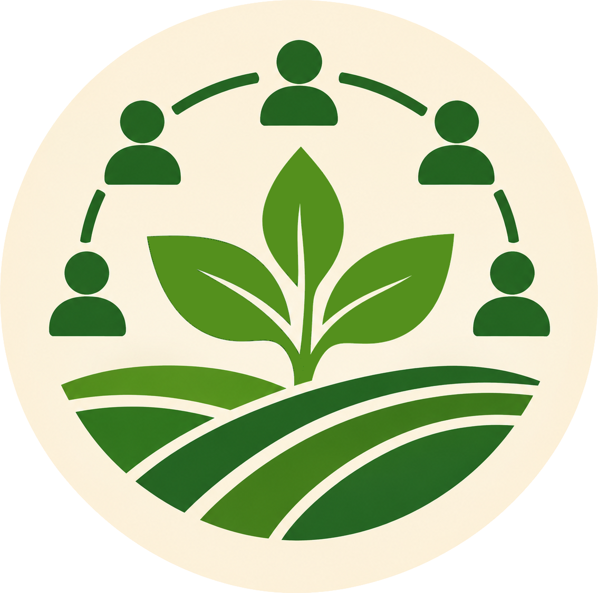

<p align="center">
  
</p>

<h1 align="center">Cultivar</h1>

<p align="center">
  <strong>Rede social aberta, descentralizada e federada para cultivo, agroecologia e colaboração socioambiental.</strong>
</p>

<p align="center">
  <a href="#documentação"></a>
  <a href="#licença"></a>
  
  
  <a href="governance/CONTRIBUTING.md"></a>
</p>

> **Nome e identidade visual provisórios.** A definição definitiva será feita
> coletivamente pela comunidade, conforme a
> [Carta de Fundação](governance/CHARTER.md) e a
> [Política de Marca e Identidade](governance/TRADEMARK_POLICY.md).

## Sobre o projeto

O Cultivar é uma iniciativa comunitária que está construindo uma infraestrutura
digital livre para pessoas, grupos e organizações envolvidos com cultivo,
agroecologia, biodiversidade e transformação socioambiental.

A proposta é oferecer uma rede aberta e federada, capaz de conectar iniciativas
que já existem, compartilhar conhecimentos e recursos, registrar experiências de
cultivo e organizar ações coletivas — sem exigir que as comunidades abandonem
seus espaços e formas próprias de organização.

O projeto não pertence a uma pessoa ou organização específica. Sua identidade,
governança e evolução são construídas coletivamente e documentadas publicamente
neste repositório.

## O que estamos construindo

- **Identidade federada:** contas locais, perfis públicos e presença no
  Fediverso por meio de WebFinger, ActivityPub e NodeInfo.
- **Diário de cultivo:** ciclos e registros cronológicos com observações,
  medidas, intervenções e resultados, privados por padrão.
- **Biblioteca de práticas:** conhecimentos reproduzíveis de cultivo e faça você
  mesmo, com versionamento, autoria e licença.
- **Aprendizagem coletiva:** conexão explícita entre prática utilizada,
  aplicação e resultado observado.
- **Colaboração:** projetos, grupos, organizações, compartilhamento de recursos
  e mobilização comunitária.
- **Federação:** interoperabilidade com outras instâncias e redes que adotam
  padrões abertos.

O Cultivar não é um sistema de gestão agrícola, um serviço de diagnóstico
agronômico ou uma rede social genérica. A dimensão educativa é baseada em
experiências e práticas compartilhadas pela comunidade.

## Princípios

- Justiça social e solidariedade.
- Sustentabilidade e respeito à biodiversidade.
- Conhecimento e recursos como bens comuns.
- Colaboração e participação comunitária.
- Descentralização e autonomia.
- Software livre e transparência.

## Estado do projeto

O projeto está em fase inicial de concepção e desenvolvimento. As decisões de
arquitetura, produto e governança ainda estão abertas à discussão comunitária e
podem ser revistas. Nenhum ADR deve ser considerado consolidado antes da rodada
de revisão com a comunidade.

A base técnica é organizada em incrementos pequenos e verificáveis. O
[roadmap](docs/ROADMAP.md) descreve as etapas previstas e o
[guia de desenvolvimento](docs/DEVELOPMENT.md) registra o que já está
implementado, as rotas disponíveis e as limitações atuais.

## Stack

- **Go 1.27** com `chi` e templates HTML renderizados no servidor.
- **PostgreSQL 17** com `pgx` e migrações versionadas com `goose`.
- **ActivityPub**, ActivityStreams, WebFinger e NodeInfo para federação.
- **Armazenamento compatível com S3** para mídia.
- **Docker Compose** para o ambiente local completo.
- **AGPL-3.0** como licença prevista para o software.

## Desenvolvimento

O ambiente local, os comandos e a configuração estão detalhados em
[**docs/DEVELOPMENT.md**](docs/DEVELOPMENT.md). Resumo do fluxo:

```sh
cp .env.example .env
make deps      # PostgreSQL e armazenamento S3 local
make migrate   # aplica as migrações
make run       # inicia o servidor em http://localhost:8080
```

Para executar a stack completa em containers:

```sh
make up
make logs
make down
```

Verificações úteis:

```sh
make ci        # go vet, testes e build
curl http://localhost:8080/healthz
curl http://localhost:8080/readyz
```

## Documentação

| Documento | Conteúdo |
| --- | --- |
| [Visão do produto](docs/VISION.md) | Propósito, problemas, conceitos e domínios funcionais. |
| [Arquitetura](docs/ARCHITECTURE.md) | Princípios, contextos, componentes e integrações. |
| [Roadmap](docs/ROADMAP.md) | Etapas de evolução e prioridades do projeto. |
| [Desenvolvimento](docs/DEVELOPMENT.md) | Ambiente local, rotas, comandos, configuração e limitações. |
| [Decisões de arquitetura (ADRs)](docs/decisions/README.md) | Registro aberto das decisões técnicas e de produto. |
| [Ficha de plantio de sementes](docs/FICHA_PLANTIO_SEMENTES.md) | Modelo de registro usado como referência para o diário. |

## Governança e comunidade

| Documento | Conteúdo |
| --- | --- |
| [Carta de Fundação](governance/CHARTER.md) | Origem, valores e princípios fundamentais da iniciativa. |
| [Modelo de Governança](governance/GOVERNANCE.md) | Papéis, processos e tomada de decisão coletiva. |
| [Guia de Contribuição](governance/CONTRIBUTING.md) | Formas de participar e padrões para contribuições. |
| [Código de Conduta](governance/CODE_OF_CONDUCT.md) | Regras de convivência e acolhimento na comunidade. |
| [Política de Marca e Identidade](governance/TRADEMARK_POLICY.md) | Separação entre o software e a identidade institucional. |

## Como contribuir

Contribuições são bem-vindas, com ou sem experiência em programação. Você pode
participar de discussões, melhorar a documentação, testar versões, relatar
problemas, revisar código ou apoiar a sustentabilidade do projeto.

Antes de começar, leia o [Guia de Contribuição](governance/CONTRIBUTING.md) e o
[Código de Conduta](governance/CODE_OF_CONDUCT.md). Mudanças relevantes devem
ser discutidas publicamente antes da implementação.

## Licença

A licença prevista para o software é a
**GNU Affero General Public License v3.0 (AGPL-3.0)**. O texto completo será
incorporado ao arquivo [LICENSE](LICENSE) quando a decisão for consolidada pela
comunidade.

A licença do software não transfere direitos sobre o nome, a marca ou a
identidade institucional do projeto. Esses elementos são tratados pela
[Política de Marca e Identidade](governance/TRADEMARK_POLICY.md).
